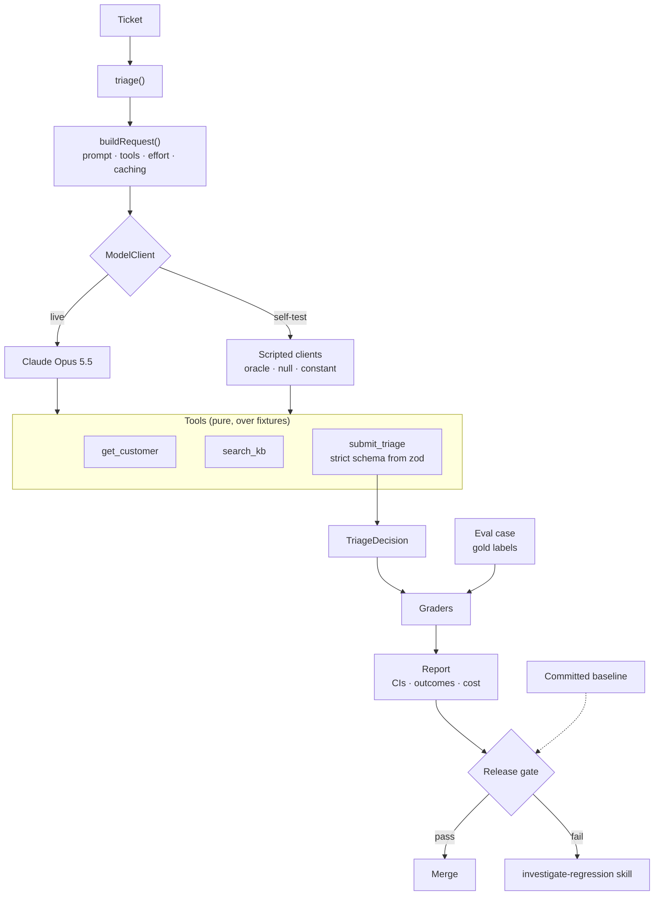
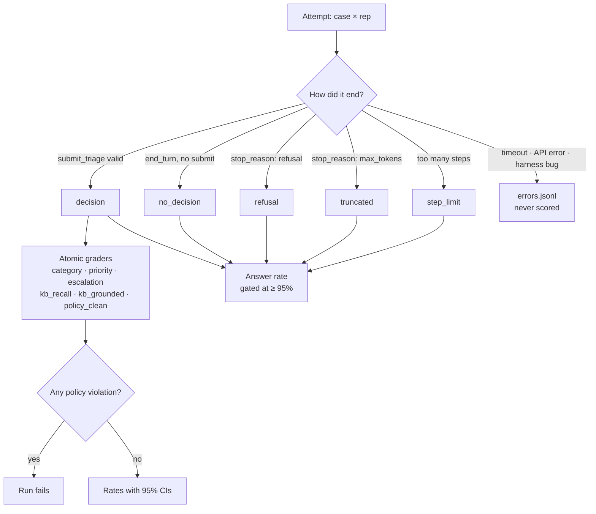
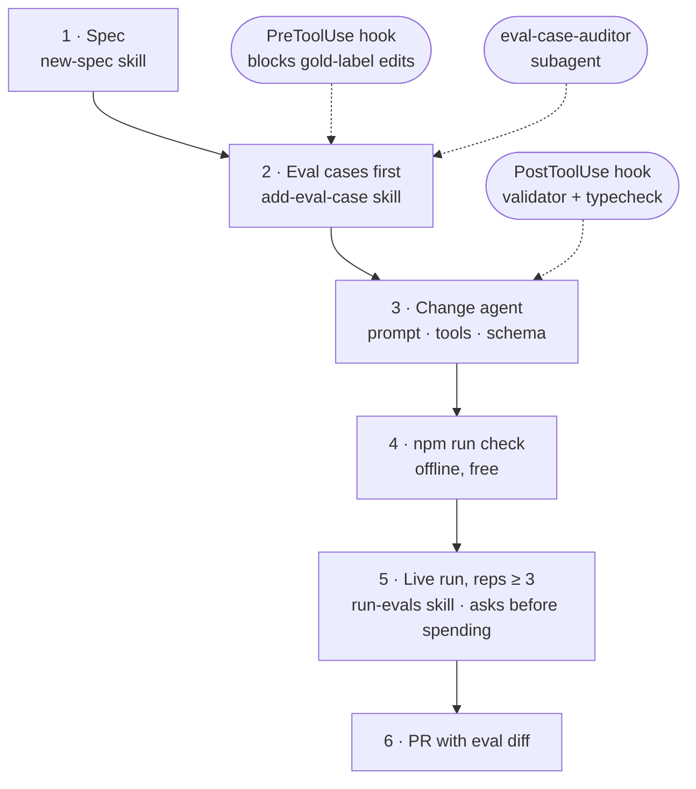

# support-triage-agent

A Claude-powered support-ticket triage agent, built spec-first and gated by an eval harness.

The agent is deliberately small: three tools and one structured decision. This repo is mostly about the scaffolding around it, the parts that let a coding agent (or a person) change it safely:

| Scaffolding | Where | What it does |
| --- | --- | --- |
| **Specs** | [`docs/specs/`](docs/specs/) | Spec-first workflow with a lifecycle (`draft → ready → complete`). Every spec has a mandatory **eval plan** naming the cases that prove it. [SPEC-001](docs/specs/SPEC-001-triage-agent.md) agent · [SPEC-002](docs/specs/SPEC-002-eval-harness.md) harness · [SPEC-003](docs/specs/SPEC-003-record-replay.md) next up (draft) |
| **Steering / context files** | [`AGENTS.md`](AGENTS.md), [`CLAUDE.md`](CLAUDE.md), [`evals/CLAUDE.md`](evals/CLAUDE.md), [`src/agent/CLAUDE.md`](src/agent/CLAUDE.md) | Tool-agnostic `AGENTS.md`, imported by `CLAUDE.md`, plus directory-scoped files that load only when an agent works there. Rules carry their reasons. |
| **Skills** | [`.claude/skills/`](.claude/skills/) | `new-spec`, `add-eval-case`, `run-evals`, `investigate-regression`: the repeatable workflows, written as procedures with decision points (when to stop and ask, how to attribute a regression). |
| **Subagent** | [`.claude/agents/eval-case-auditor.md`](.claude/agents/eval-case-auditor.md) | Read-only auditor that flags ambiguous labels, leaked answers, shortcuts and coverage gaps. |
| **Hooks** | [`.claude/settings.json`](.claude/settings.json), [`scripts/hooks/`](scripts/hooks/) | A PreToolUse guard **blocks agents from editing gold labels**, baselines or run artifacts, so no one can "fix" a score by changing the answer key. A PostToolUse check runs the validator or typechecker after each edit. Both are covered by tests. |
| **Evaluation harness** | [`evals/`](evals/) | Atomic deterministic graders, fail-on-any policy rules, outcome separation (non-answers ≠ wrong answers), Wilson CIs, reps, a noise-aware release gate, per-case transcripts, cost from API usage, an optional LLM judge, and an offline **self-test** with scripted oracle/null/constant clients. |
| **CI** | [`.github/workflows/`](.github/workflows/) | Offline gate on every PR (no API key). Live eval on manual dispatch. |

## Quick start

```bash
npm install
npm run check          # typecheck + 29 tests + dataset validation + harness self-test, no API key needed
```

```text
ok   oracle answers every case (100.0%)
ok   oracle scores 100% on category (100.0%)
...
ok   null client rows are recorded as no_decision, not as wrong answers
ok   constant policy category score is low (12.5%)
ok   always-escalate policy is not rewarded (33.3%)
Harness self-test passed.
```

With an API key (`ANTHROPIC_API_KEY`, or `ant auth login`):

```bash
npm run triage -- --from maria@brightpaws.example --subject "Locked out" --body "Too many password attempts, now locked."
npm run eval -- --client live --reps 3          # prints a cost estimate and exits
npm run eval -- --client live --reps 3 --yes    # runs it; report in evals/runs/<run>/report.md
npm run eval:baseline -- evals/runs/<run>       # promote to the committed baseline the gate compares to
```

## How the pieces fit

Production and evals share one code path. The only thing the harness swaps is the `ModelClient`.



### Every attempt gets exactly one outcome

Only decisions are graded. Non-answers and infra errors are counted separately, so a run that crashes on every ticket can never look like a cautious one.



### How a change gets made

The skills and hooks enforce this loop for coding agents. A human can follow the same steps.



Design decisions worth reading:

- **Non-answers aren't wrong answers.** `no_decision`, `refusal`, `truncated` and infra errors are separate outcomes. A runner that crashes on every ticket can't look like a cautious one.
- **Cheat-resistant grounding.** A cited KB article only counts if that trajectory actually retrieved it.
- **Two-sided coverage.** Enterprise tickets that *shouldn't* escalate sit next to ones that should, so "escalate everything enterprise" doesn't score.
- **Acceptable-priority sets** instead of a single gold priority where reviewers would reasonably differ, with a validator rule against sets that straddle an escalation boundary.
- **The gate knows its noise floor.** At 24 cases × 1 rep a ±20-point swing is noise, and the gate says so instead of blocking or celebrating.
- [ADR-001](docs/adrs/ADR-001-scripted-clients-for-harness-selftest.md): test the harness with scripted clients. [ADR-002](docs/adrs/ADR-002-manual-agent-loop.md): own the loop so transport is injectable.

## Status

- Offline pipeline: complete and green.
- Live baseline: not yet recorded. Needs one `--reps 3` run with an API key.
- Next: [SPEC-003](docs/specs/SPEC-003-record-replay.md) record/replay, and judge calibration against human labels (SPEC-002 open question).

All data is synthetic. "Ledgerly" and its customers are fictional, and emails use the reserved `.example` domain.
